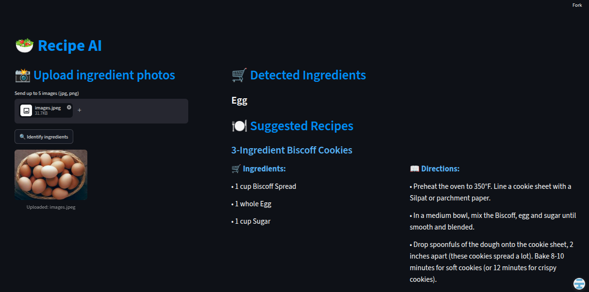

## 🥗 Recipe AI - Ingredient Classifier and Recipe Recommender

### 📌 Overview

Recipe AI is a web application that uses deep learning to classify food ingredients from images and then recommends recipes based on the detected ingredients. The app integrates a pre-trained MobileNet model for ingredient recognition and a nearest neighbors search on a recipe dataset to find similar recipes.

Built with Streamlit, TensorFlow, and scikit-learn, this project offers an intuitive interface for users to upload photos of ingredients and get personalized recipe suggestions instantly.

### 🚀 Features

- **Ingredient Classification**: Upload up to 5 images of food ingredients and get the top prediction using a MobileNet-based deep learning model trained on a 15-class of food database with TensorFlow. The model provides a 90.57% accuracy.

- **Recipe Recommendation**: The application finds and displays 3 recipes using the detected ingredients from a large recipe dataset using a nearest neighbors model, an efficient search strategy using TF-IDF vectors and cosine similarity.

- **User-Friendly UI**: Responsive layout for user interaction developed with Streamlit, displaying the recipes in a clean and organized screen.

### 🗃️ Repository Organization

- The recipe search and recommendation model was firstly developed in a separated api for test purposes, and then implemented in the streamlit application. The code for the api can be found at “api” folder

- The main code for integrating both ingredient classification model, recipe search and recommendation model and user interface can be found at “app” folder

- There are 3 notebooks used for the project:
  - “**ingredients_dataset**”: Python script to scrape ingredient images from the web and create a 15-class food dataset. It is also responsible for removing corrupted or low-quality images and dataset split.
  - “**recipe_generator.ipynb**”: Analysis of "RecipeNLG_dataset" from Kaggle, with numerous cooking recipes. It also contains the training of the recommendation model using the Nearest Neighbors algorithm from sckit-learn library.
  - “**ingredient_classification.ipynb**”: MobileNetV2 training using the deep learning API Keras, from TensorFlow, using the generated ingredients dataset.

### 🤗 Model on Hugging Face

The ingredient classification model is publicly available on
[Hugging Face](https://huggingface.co/isabelagregio/recipe-ai-ingredient-classifier).

The model uses MobileNetV2 with TensorFlow/Keras to classify food images into 15 ingredient categories.

**Model details:**
- Architecture: MobileNetV2
- Framework: TensorFlow / Keras
- Input: 224 × 224 RGB images
- Classes: 15 food ingredients
- Reported classification accuracy: 90.57%

The Streamlit application downloads the model from the Hugging Face Hub and caches it locally for inference. For model usage, preprocessing instructions, and limitations, see the Hugging Face Model Card.

### 💻 Link to project: https://recipe-ai-generator.streamlit.app/

#### Recipe Dataset Credit: https://www.kaggle.com/datasets/paultimothymooney/recipenlg
